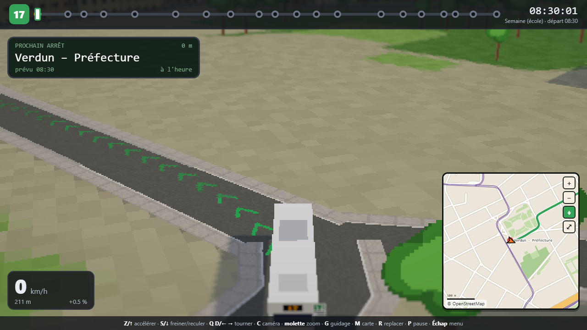

# Simulateur Bus 17

_[English](README.md)_

Un jeu de conduite de bus dans le navigateur, sur le vrai parcours de la ligne 17 de
Grenoble (Verdun – Préfecture ⇄ Meylan, Lycée du Grésivaudan) : vraies rues, vrai relief,
vrais arrêts et horaires. Pensé d'abord pour un passionné de bus de 12 ans, puis pour tous.

C'est un prototype avec deux moteurs de rendu :

- **HD-2D** : ville en 3D basse résolution au rendu pixel art, conduite libre dans les
  rues (la piste principale) ;
- **Pseudo-3D** : route façon OutRun qui suit le parcours.



## Démarrage rapide

Il faut Python 3 (une version récente) et un navigateur récent sur PC.

```sh
git clone https://github.com/Skitourer/bus-17-simulator.git
cd bus-17-simulator
python -m http.server 8017
```

Puis ouvrir <http://localhost:8017/>, choisir un sens, un jour et un départ, et conduire.
Touches : Z/↑ accélérer · S/↓ freiner puis reculer · Q D/← → tourner · M carte · P pause.

## Regénérer les données

Les fichiers JSON de `data/grenoble/` sont produits par les scripts de `tools/`
(bibliothèque standard Python uniquement, accès réseau nécessaire ; les téléchargements
sont mis en cache dans `tools/cache/`) :

```sh
python tools/build_line.py
python tools/build_map.py
python tools/build_terrain.py
python tools/build_buildings.py
```

## Documentation

- Cahier des charges : [CAHIER_DES_CHARGES.md](CAHIER_DES_CHARGES.md)
- Contribuer : [CONTRIBUTING.md](CONTRIBUTING.md) · Sécurité : [SECURITY.md](SECURITY.md)

## Licence et données

- Code source : [MIT](LICENSE). Three.js (`vendor/`) : MIT, © auteurs de Three.js.
- Tracé, arrêts, horaires : GTFS M réso (SMMAG), [ODbL](https://opendatacommons.org/licenses/odbl/).
- Rues, bâtiments, arbres, eau, parcs : © [contributeurs OpenStreetMap](https://www.openstreetmap.org/copyright), ODbL.
- Altitude : IGN RGE ALTI, [Licence Ouverte 2.0](https://www.etalab.gouv.fr/licence-ouverte-open-licence/).

Les fichiers de `data/` sont des bases de données dérivées et restent sous ODbL /
Licence Ouverte. La livrée du bus est imaginaire ; ce projet n'est pas affilié à M réso
ni au SMMAG.

Développé avec l'aide de Claude (Anthropic).
