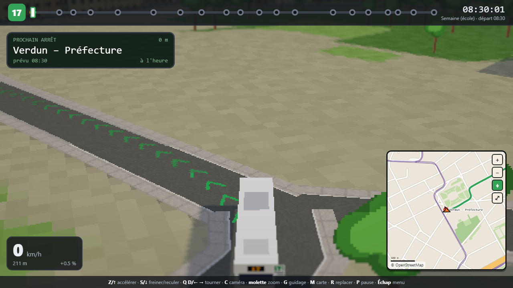

# Bus 17 simulator

_[Français](README.fr.md)_

A bus-driving game in the browser, on the real route of Grenoble bus line 17
(Verdun – Préfecture ⇄ Meylan, Lycée du Grésivaudan): real streets, real elevation,
real stops and timetables. Made first for a 12-year-old bus fan, then for anyone.

It is an early prototype in **HD-2D**: a low-resolution 3D city with a pixel-art look,
where you drive freely in the streets.



**Play online: <https://skitourer.github.io/bus-17-simulator/>** (desktop browser).

## Quick start

Needs Python 3 (any recent version) and a recent desktop browser.

```sh
git clone https://github.com/Skitourer/bus-17-simulator.git
cd bus-17-simulator
python -m http.server 8017
```

Then open <http://localhost:8017/>, pick a direction, a day and a departure, and drive.
Keys: Z/↑ accelerate · S/↓ brake then reverse · Q D/← → steer · M map · P pause.

## Development

Needs Node.js 22+ and [uv](https://docs.astral.sh/uv/).

```sh
npm ci && uv sync
uv run pre-commit install
npm run check        # Prettier, type check, JavaScript tests
uv run poe check     # ruff, pyright, Python tests
uv run poe serve     # http://localhost:8017/ without browser caching
```

The JSON files in `data/grenoble/` are generated by the scripts in `tools/` (network
access needed; downloads are cached in `tools/cache/`):

```sh
uv run python tools/build_line.py
uv run python tools/build_map.py
uv run python tools/build_terrain.py
uv run python tools/build_buildings.py
uv run python tools/build_roads.py
```

## Documentation

- Requirements (French): [CAHIER_DES_CHARGES.md](CAHIER_DES_CHARGES.md)
- Decisions: [docs/adr/](docs/adr/)
- Contributing: [CONTRIBUTING.md](CONTRIBUTING.md) · Security: [SECURITY.md](SECURITY.md)

## Licence and data

- Source code: [MIT](LICENSE). Three.js (`vendor/`): MIT, © Three.js authors.
- Route, stops, timetables: GTFS M réso (SMMAG), [ODbL](https://opendatacommons.org/licenses/odbl/).
- Streets, buildings, trees, water, parks: © [OpenStreetMap contributors](https://www.openstreetmap.org/copyright), ODbL.
- Elevation: IGN RGE ALTI, [Licence Ouverte 2.0](https://www.etalab.gouv.fr/licence-ouverte-open-licence/).

The files in `data/` are derived databases and remain under ODbL / Licence Ouverte.
The bus livery is imaginary; this project is not affiliated with M réso or SMMAG.

Developed with the help of Claude (Anthropic).
